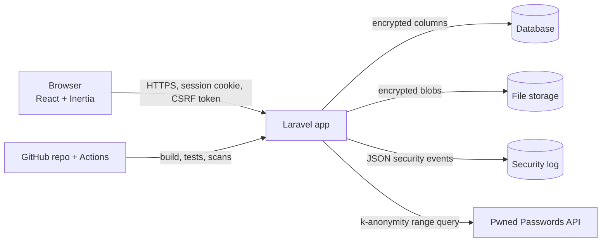
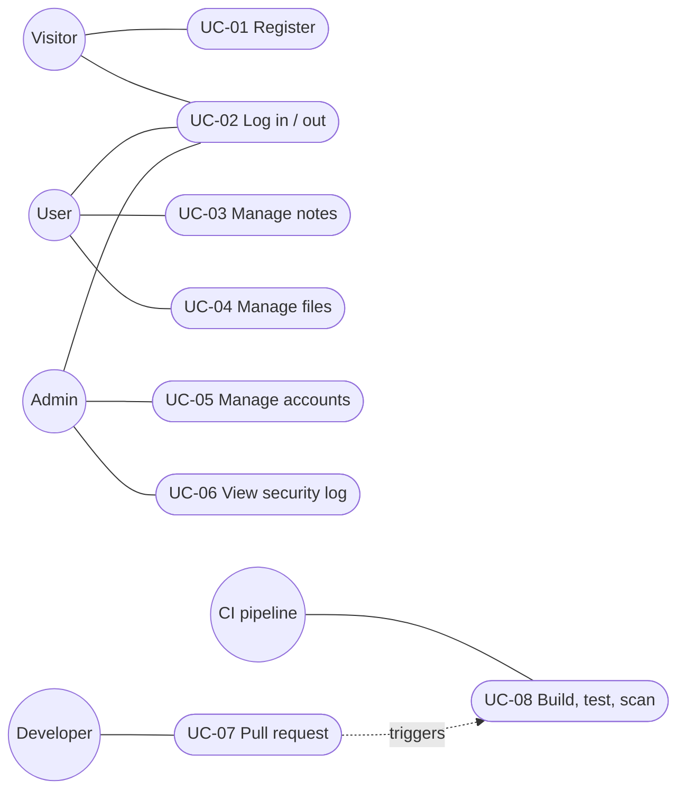

# 1. System and use cases

## The application

**DevSecOps Vault** is a small web application where people keep private notes and files. It is deliberately
small, but it has every part an attacker looks for: accounts and passwords, private data, file uploads, an
admin role, a database, secrets and a CI/CD pipeline.

| Part | Technology |
|---|---|
| Backend | PHP 8.4, Laravel 13 (sessions, CSRF, validation, Eloquent ORM) |
| Frontend | React 19 via Inertia.js 3, built with Vite 8 (no API tokens in the browser: same-origin session cookie) |
| Database | SQLite locally (any Laravel-supported DB in production); note fields encrypted per column |
| File storage | `storage/app/private/vault/<uuid>.bin`, every file AES-256-GCM encrypted |
| Logging | `storage/logs/security-YYYY-MM-DD.log` (JSON lines) + the normal application log |
| Repository / CI | GitHub (public), GitHub Actions, CodeQL, Dependabot |

## Users (actors)

| Actor | Description | Trust |
|---|---|---|
| Visitor | Not logged in. Can only register or log in. | none |
| User | Owns notes and files. Sees only their own data. | authenticated |
| Admin | Manages accounts (enable/disable) and reads the security log. **Cannot** read other users' notes or files (least privilege). | authenticated + role |
| Developer | Changes code through pull requests on GitHub. | repository write |
| CI pipeline | Builds, tests and scans every change. | read-only token |

## Use cases

| ID | Use case | Actor |
|---|---|---|
| UC-01 | Register an account | Visitor |
| UC-02 | Log in / log out | Visitor, User, Admin |
| UC-03 | Create, read, edit, delete own notes | User |
| UC-04 | Upload, download, delete own files | User |
| UC-05 | List users, enable/disable an account | Admin |
| UC-06 | View the security log | Admin |
| UC-07 | Change code via a pull request | Developer |
| UC-08 | Build, test and scan a change | CI pipeline |

*Mermaid has no UML use-case diagram type; actors are circles, use cases rounded boxes. For the
presentation the same diagram can be drawn in draw.io / PlantUML (`@startuml ... actor User ... (Manage notes) ... @enduml`).*
