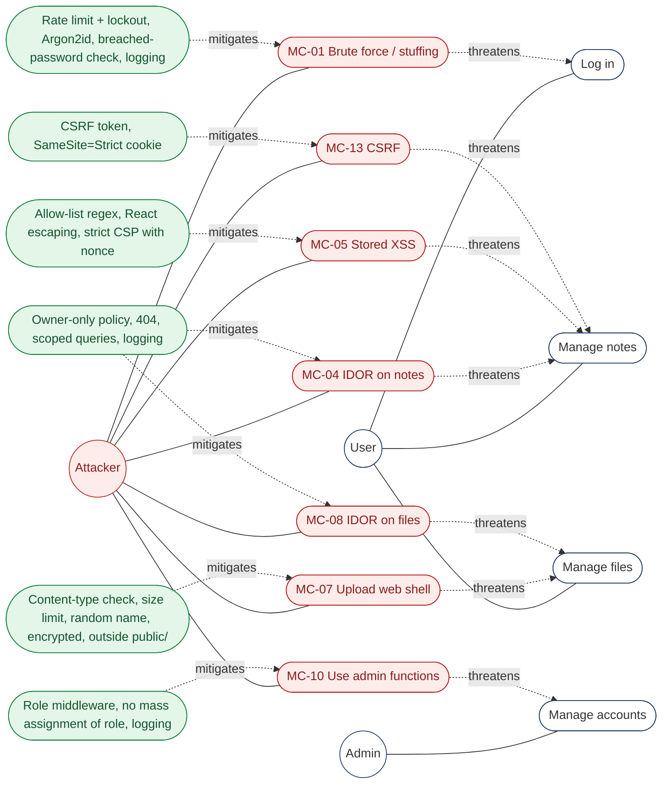

# 3. Misuse cases and countermeasures

## 3.1 Misuse case diagram

Use cases (white) are threatened by misuse cases (red) of an attacker; countermeasures (green)
*mitigate* the misuse case.

## 3.2 Misuse case table

| ID | Misuse case | Threatens | Risk | Countermeasures (where in the code) |
|---|---|---|---|---|
| MC-01 | Attacker brute-forces or stuffs passwords; steals or fixes a session | UC-02 | R1 | 5 attempts/min per e-mail+IP then lockout (`LoginController`), Argon2id (`config/hashing.php`), min 12 / max 128 + Pwned Passwords check (`RegisterRequest`), session id regenerated after login, `auth.login.failed` / `auth.lockout` events |
| MC-02 | Attacker finds out which e-mails have an account | UC-02 | R13 | One generic error; a dummy hash is verified for unknown e-mails so timing is equal (`LoginController::dummyHash`) |
| MC-03 | Attacker registers with `role=admin` | UC-01 | R9 | `role`/`is_active` not fillable (`User`), secure default `user` in migration and model |
| MC-04 | User changes the id in `/notes/{id}` or posts `user_id` | UC-03 | R2 | `NotePolicy` owner-only, denied as 404; notes created through `$user->notes()`; `authz.denied` event |
| MC-05 | User stores `<script>` in a note to attack whoever opens it | UC-03 | R3 | Allow-list regex on title, control chars rejected in body (`InputRules`), JSON_HEX_TAG page data + React text rendering, CSP `script-src 'self' 'nonce-…'` (`SecurityHeaders`) |
| MC-06 | Attacker injects SQL or obtains a DB dump | UC-03 | R7, R8 | Eloquent parameterised queries only; note title/body and file names encrypted with AES-256-GCM (`encrypted` cast) |
| MC-07 | Attacker uploads a web shell or traverses the path | UC-04 | R6 | `mimes` check on file **content**, size limit, file-name regex, random UUID name, stored in `storage/app/private` (not web-reachable), always served as attachment `application/octet-stream`, 10 uploads/min |
| MC-08 | User downloads/deletes someone else's file | UC-04 | R2 | `VaultFilePolicy` owner-only, 404 |
| MC-09 | Attacker steals or modifies the file storage | UC-04 | R7 | AES-256-GCM with a separate key; record id as AAD; SHA-256 integrity check; fail closed + `crypto.file.integrity_failed` |
| MC-10 | Normal user calls admin routes; admin abuses role | UC-05, UC-06 | R9, R12 | `admin` middleware, `authz.admin.denied` event; admins cannot read content; every admin action logged with actor and target; admin cannot disable self |
| MC-11 | Attacker frames the site (clickjacking) or sniffs cookies | all | R14 | `frame-ancestors 'none'`, `X-Frame-Options: DENY`, HSTS, cookies `Secure; HttpOnly; SameSite=Strict`, encrypted session |
| MC-12 | Attacker reads internals from errors, or forges log lines | all | R11 | `APP_DEBUG=false` default and enforced in production (`ConfigValidator`), generic error page with only a request id, JSON log encoding (CR/LF cannot start a new entry) |
| MC-13 | Attacker makes the victim's browser send a request (CSRF) | UC-03, UC-05 | R10 | Laravel CSRF token (XSRF cookie → header, checked server-side), SameSite=Strict, `input.csrf.rejected` event |
| MC-14 | Secrets leak via the repository, logs or config | all | R4 | `.env` git-ignored, keys only in env / GitHub secrets, gitleaks in CI + pre-commit, log redaction, config validated at boot, separate keys for DB and files |
| MC-15 | Attacker exploits a known-vulnerable dependency | all | R5 | Dependabot alerts/updates, `composer audit` + `npm audit` in CI, lock files, `npm ci --ignore-scripts` |
| MC-16 | Attacker hijacks a GitHub Action or pushes to `main` | UC-07, UC-08 | R5 | Actions pinned to commit SHAs, `permissions: contents: read`, `persist-credentials: false`, zizmor + actionlint, ruleset on `main`, CODEOWNERS, settings-drift job |
