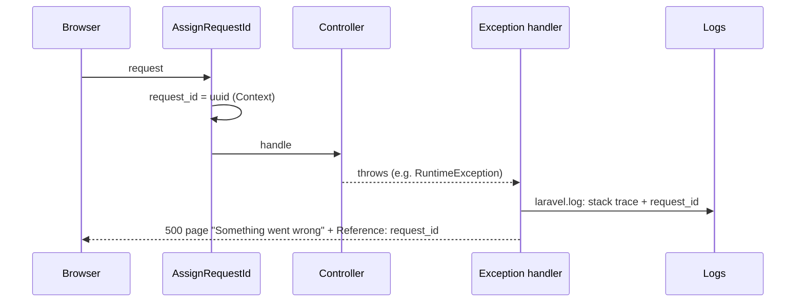

# 5. Secure coding and technical design

This chapter is the detailed technical design of the selected controls (the ones that address the top
risks R1–R6) and how they meet the course guidelines.

## 5.1 Input validation (every input: users, requests, configuration)

**Principle:** allow-list (describe what is *allowed*), check type, length *and* format, on the server.
The `maxLength`/`minLength` attributes in the React forms only help the user and can be bypassed.

| Input | Where | Rules |
|---|---|---|
| Name | `RegisterRequest` | `max:60`, regex `InputRules::NAME` |
| E-mail | `RegisterRequest`, `LoginRequest` | `max:254` (RFC 5321), `email:rfc,strict`, unique |
| Password | `RegisterRequest` | 12–128 chars, confirmed, not in a breach (Pwned Passwords) |
| Note title / body | `NoteRequest` | `max:120` + `TITLE` regex / `max:10000` + `MULTILINE` regex |
| Uploaded file | `FileUploadRequest` | `max` KB, `mimes` (detected from the **content** by `finfo`), name regex `FILE_NAME` |
| Route ids | Laravel route model binding | Must be an existing primary key, otherwise 404 (no raw SQL) |
| Configuration | `ConfigValidator` (boot + `php artisan vault:check-config`) | Key format, length 32 bytes, keys differ, production: debug off, https, Secure cookie |
| Request id header | `AssignRequestId` | The client's `X-Request-Id` is ignored; the server generates its own |

### The regular expressions (`app/Support/InputRules.php`)

| Name | Pattern | Explanation |
|---|---|---|
| `NAME` | `/^[\p{L}\p{M}][\p{L}\p{M} '.-]{1,59}$/u` | Starts with a letter in any language (`\p{L}`), optionally with accents (`\p{M}`); then letters, space, apostrophe, dot, hyphen; 2–60 chars in total. No digits, no `<>`, no quotes besides `'`. |
| `TITLE` | `/^[^\p{C}<>]{1,120}$/u` | Any character **except** control/format characters (`\p{C}`: NUL, ESC, newline, zero-width, …) and angle brackets. |
| `MULTILINE` | `/^(?:[^\p{C}]\|[\t\r\n])*$/u` | Same as above, but tab, CR and LF are allowed so a note can have lines. |
| `FILE_NAME` | `/^[\w\- ().]{1,100}\.(pdf\|png\|jpe?g\|txt)$/iu` | Word characters, space, hyphen, brackets, dot; must end in an allowed extension. No `/`, `\`, NUL. |

The `/u` flag makes PHP treat the input as UTF-8 and reject invalid byte sequences. Length is always also
checked with `max:` first, so a regex never runs on a megabyte of input. None of these patterns has nested
quantifiers, so there is no catastrophic backtracking (ReDoS). `tests/Unit/InputRulesTest.php` has 21
accept/reject examples, including `<script>`, `' OR 1=1 --`, NUL bytes, ANSI escape codes and
`../../etc/passwd`.

Validation does not replace output encoding: a note *may* contain `<b>` in its body, and that is safe
because React always renders it as text and the page JSON is encoded with `JSON_HEX_TAG`.

## 5.2 Secrets management

| Secret | Where it lives | Never |
|---|---|---|
| `APP_KEY` (sessions, cookies, DB column encryption) | `.env` locally (git-ignored); in production an environment variable from the host's secret store | in git, in logs, in the frontend |
| `VAULT_FILE_KEY` (file encryption) | Same, but a **different** key (`php artisan vault:key`) | equal to `APP_KEY` (rejected at boot) |
| DB credentials | `.env` / environment | in config files |
| Admin seed password | Only in the environment while running `db:seed`, then removed | as a default in code |
| CI secrets | GitHub Actions secrets in a protected **environment** (`security-audit`) | printed (GitHub masks them) |

How the OS and language help: Laravel reads secrets through `env()` only inside `config/*.php`, and in
production `php artisan config:cache` puts them in a cached PHP file that only the web user can read
(`chmod 600`). Laravel can also encrypt the env file itself (`php artisan env:encrypt`, which writes
`.env.encrypted` with AES-256-CBC); only the decryption key then has to be given to the server. On Linux
the process environment is readable only by the same user and root (`/proc/<pid>/environ`).

Leak prevention: gitleaks as a pre-commit hook and in CI (whole history, with a canary test), GitHub
push protection when the repository is public, the log redaction list in `SecurityLog::REDACT`, and
`dontFlash` so passwords never come back in validation responses.

## 5.3 Secure defaults and null handling

* Configuration defaults are the *secure* value when a variable is missing (`config/*.php` second argument):
  `APP_DEBUG=false`, `SESSION_ENCRYPT=true`, `SESSION_SECURE_COOKIE=true`, `SameSite=strict`,
  `SESSION_LIFETIME=30`, `HASH_DRIVER=argon2id`, `LOG_LEVEL=info`.
* Database defaults: `role = 'user'`, `is_active = true`; the model sets the same in `$attributes`, so
  even an object that hasn't been saved yet is never an admin.
* **Null is never treated as "allowed":** `isAdmin()` is `role === 'admin'` (null → false), `?->` is
  used for an optional user (`$request->user()?->isAdmin()` → null → denied), and `ConfigValidator` treats
  `app.debug = null` as *not off* (`!== false`). The test `debug unset (null) is not "off"` covers this.
* Unknown file format, missing blob or wrong key → `null` plaintext → 500 (fail closed), never partial data.

## 5.4 Exception handling: crash safely

* Expected failures are caught where they happen and turned into a safe result: `FileCrypto` throws
  `RuntimeException` on tampering, `FileController` catches it, logs `crypto.file.integrity_failed`
  (level error) and answers 500 without data.
* Unexpected failures go to the central handler (`bootstrap/app.php`), which logs them with the request
  id and shows a generic page (Blade for normal requests, the `Error` React page for Inertia requests).
  The user only sees a reference; the developer finds the full trace by searching for that id.
* `APP_DEBUG=true` would show the stack trace, so production refuses to start with it (`ConfigValidator`).
* No `@` error suppression and no empty `catch` blocks: each catch logs and returns a defined result.

## 5.5 What else the secure coding standard says

Besides the topics above, the OWASP Secure Coding Practices checklist and the Proactive Controls also
cover the following. Here is how each is handled in the vault:

| Area | Practice | In the vault |
|---|---|---|
| Output encoding | Encode per context (HTML, JS, URL) | React/Blade escaping, `JSON_HEX_TAG`, no `dangerouslySetInnerHTML` |
| Authentication | Generic errors, re-authentication for sensitive actions, secure password storage | Generic error, Argon2id; re-auth: future |
| Session management | New id after login, logout invalidates, timeout, cookie flags | All implemented |
| Access control | Server-side, deny by default, per object | Policies + middleware |
| Cryptographic practices | Approved algorithms, CSPRNG, protected keys | AES-GCM, Argon2id, `random_bytes` |
| Error handling and logging | No sensitive data in errors or logs, log security events | Chapter 5.4 + 6 |
| Data protection | Least data in responses, no sensitive data in URLs, caching headers | Explicit prop allow-lists (`present()`), ids only in URLs |
| Communication security | TLS everywhere, HSTS | HSTS, Secure cookies, TLS check in chapter 7 |
| System configuration | Remove unused features, minimal headers | Only needed packages, `X-Powered-By` removed, no source maps |
| Database security | Parameterised queries, least-privilege DB user | Eloquent; production DB user without `DROP`/`GRANT` |
| File management | Validate type by content, store outside web root, never execute | Chapter 5.1 + MC-07 |
| Memory management | (mainly C/C++) | Not applicable to PHP; see 5.6 |

## 5.6 Bonus: code signing and compiler hardening

* **Signing:** PHP is not compiled, so there is no binary to sign. What *can* be signed are the commits
  (SSH or GPG signing, enforced by the "require signed commits" rule) and the build artefact
  (`public/build`): `actions/attest-build-provenance` creates a Sigstore-signed SLSA provenance that
  anyone can check with `gh attestation verify`. This proves which workflow and which commit produced it.
* **Compiler security settings** matter for C/C++/Rust/Go binaries: stack protector
  (`-fstack-protector-strong`), `_FORTIFY_SOURCE=3`, PIE + ASLR (`-fPIE -pie`), full RELRO
  (`-Wl,-z,relro,-z,now`), non-executable stack (`-z noexecstack`) and Control-Flow Integrity. For this
  application they apply to the PHP interpreter itself. Debian/Ubuntu PHP packages are built with them,
  which can be checked with `checksec --file=/usr/bin/php8.4`. On the PHP side, the equivalent
  "hardening flags" are `php.ini` settings: `expose_php=Off`, `display_errors=Off`,
  `allow_url_include=Off`, `disable_functions=exec,passthru,shell_exec,system,proc_open,popen`,
  `session.use_strict_mode=1` and `open_basedir`.
